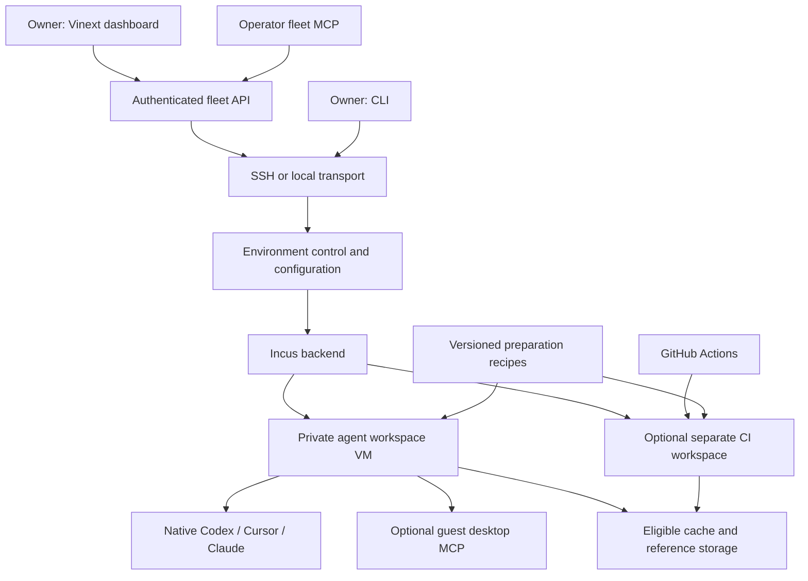

# Portable self-hosted environment design

Status: implementation design updated October 24, 2026. The Rust runtime, bootstrap, native-client/browser preparation, fleet REST/MCP and Vinext dashboard are implemented. Compatible Rust service upgrades and rollback are tested; initial legacy cutover, portable cache services, live CI and backup/recovery qualification remain separate work. See the operational guides for supported commands.

## Outcome

An owner connects a Linux server, prepares a workspace once, signs into the official Codex, Cursor Agent or Claude Code client, and works through the ordinary terminal. Files, compatible dependencies and caches remain available. Optional CI uses the same preparation contracts to return reliable build/test results sooner.

Start with one trusted owner and one server. Support different server providers and existing compatible Incus installations through configuration, rather than hardcoding one machine. Launching an official CLI and resuming its native conversation belong in the environment API. Agent planning, task delegation between workers, a model gateway and a replacement CI scheduler remain outside this product.

## Components

The core owns environment lifecycle, preparation manifests, storage/mount interfaces and resource limits. The native-client recipe installs official binaries and configures supported local tools; it does not sit between the harness and provider. The CI module owns runner registration, job preparation, cache mappings and CI measurements. A workspace remains usable without GitHub or a runner.

The first backend is Incus. Keep backend-specific operations behind a small internal interface, but implement only this backend until another real deployment requires more. Local and SSH transports should support the same operations.

## Initial support contract

| Area | Initial target and evidence |
|---|---|
| Operator | Native Rust CLI/controller on Linux, macOS and Windows; OpenSSH for remote Linux nodes. Native builds/tests passed on all three platforms. Personal resource contribution is a separate backend qualification. |
| Host | Linux x86_64 with `/dev/kvm`, sufficient disk/RAM and administrator access. Reference prototype: Ubuntu 26.04, Incus 6.0.5, QEMU 10.2. |
| Guest | Ubuntu 24.04 x86_64, configurable non-root user and workspace paths. |
| Server provider | Dedicated hardware, or a VM exposing usable KVM; provider-independent configuration. |
| Next qualification tracks | Personal macOS/Windows resource contributors, ARM Linux containers, native Windows/macOS workers and explicit GPU allocation. These are planned backends, not capabilities of the current Incus implementation. |
| Separate acceptance gates | Windows/macOS guest images, GPU editor support, cross-host migration, hostile tenancy and automatic fleet scheduling. |

Publish a tested host/kernel/Incus/QEMU matrix. Current upstream [Incus requirements](https://linuxcontainers.org/incus/docs/main/requirements/) must not be confused with the requirements of the specific release tested in the prototype. Do not install a moving package stream and claim support for every Ubuntu host.

## Configuration and bootstrap

Use a versioned, secret-free TOML file validated by the Rust runtime. [The bootstrap example](../examples/enginebox.example.toml) is supported by `init`, `doctor`, `plan` and `apply`. [Fleet configuration](../examples/fleet.example.toml) lists hosts, reserves and approved snapshots. The lower-level runtime uses explicit environment variables or internal configuration objects.

Configuration describes transport/host, Incus project/profile, existing or managed network, storage pool, guest resources/identity, native-client selection and optional modules. Mount/cache policies remain a separate unimplemented extension. Credentials belong in native clients or short-lived setup input, never this file.

Command status:

| Command | Contract |
|---|---|
| `ebox init` | Write an example config; no host access or mutation. |
| `ebox doctor` | Read-only capability and conflict checks; readable and JSON results. |
| `ebox plan` | Show desired/observed differences, ownership, operations, resource impact and conflicts. |
| `ebox apply` | Apply a validated plan with a host lock, recheck relevant state, record progress and verify postconditions. |
| Clean-base preparation | Implemented within `ebox apply`; no separate `ebox image prepare` command yet. Writes installed versions and captures a pre-login snapshot. |
| `ebox module ci ...` (planned) | Explicit optional runner setup and maintenance; core bootstrap never registers runners implicitly. |

Existing runtime commands (`list`, `shell`, `exec`, `pause`, `resume`, `hibernate`, `stop`, `snapshot`, `fork`, `restore`) use the environment values returned by bootstrap. Fleet operations construct per-host runtime objects, keeping hosts isolated from process-wide environment changes.

Bootstrap stages:

1. Inspect OS/architecture, KVM, Incus/QEMU compatibility, available resources, storage, networks, routes and existing services. Check stateful-VM capability and device compatibility when memory restoration is requested; reserve sufficient memory-state storage (`size.state`) for configured RAM plus overhead and include it in disk-reserve calculations.
2. Resolve a plan. Reject conflicting names/subnets/ports and insufficient resources before package or network changes.
3. Install supported packages only when requested; record versions. Reuse a compatible existing installation.
4. Create owned storage/network/profile resources, or explicitly adopt selected existing ones. Names alone do not establish ownership.
5. Launch and prepare a guest, install selected official clients as its user, and verify versions and tools without signing in.
6. Create a clean base, write a preparation manifest and show the native login/access instructions.

A second apply should be a no-op when desired state is unchanged. An interrupted apply should resume from verified state; it must not assume an earlier step succeeded. Do not automatically retry destructive operations. Removal targets only owned resources and requires an explicit data-deletion action for user disks.

## Storage, cache and network model

Prefer an existing compatible storage pool. Offer bounded loop-backed storage as an explicit development option; never automatically repartition a disk. [Incus documents storage backend tradeoffs](https://linuxcontainers.org/incus/docs/main/explanation/storage/).

| Data | Handling |
|---|---|
| Writable project and installed dependency tree | Private VM disk; snapshot/fork uses the backend's copy-on-write facilities where supported. |
| Large repository and asset references | Versioned read-only mounts near compute; each workspace gets independent writable state. |
| Download/build caches | Tool-supported reuse, separated by trust domain, OS/architecture and relevant toolchain/input keys. |
| Provider account state | Private controller refresh credentials; access-only credentials delivered to the same owner’s assigned workspaces. Never stored in caches or clean bases. |
| Git and browser account state | Private workspace identity, with separate explicit authorization. |
| External data | Its own backup and versioning policy; not implicitly captured by a VM snapshot. |

The prototype used guest NFS because its Incus version rejected direct shared devices with stateful migration enabled. Generalize this as an optional mount backend. Initially use an existing suitable NFS endpoint or an isolated, explicitly provisioned service. Do not disable unrelated rpcbind/statd services, replace global NFS bindings or claim arbitrary shared mounts support memory restoration.

Detect UFW/nftables/Docker policies and subnet overlaps. Plan narrow, owned rules; preserve unrelated workloads. Desktop access must be authenticated and inaccessible to unrelated guests, even on a private bridge. A private IP is not an authentication mechanism.

## Lifecycle and identity

- Pause retains RAM and consumes host memory. Resume continues that process tree.
- Hibernate writes memory to storage and frees running memory; time depends on memory contents and storage. Connections can expire while suspended.
- A disk-only fork boots fresh. It does not continue the source process tree.
- A running private checkpoint may contain disk, RAM, provider tokens and conversation history. Keep it within the owner's access boundary.
- A reusable base is built before login. Template preparation must handle machine identity, hostname and host keys in addition to unique network identity.
- Snapshot retention and off-host backup are separate functions. Test export/restore; a same-pool snapshot does not survive losing the pool. [Incus backup semantics](https://linuxcontainers.org/incus/docs/main/howto/instances_backup/)

Lifecycle changes need serialized operations and state rechecks. Reject conflicting operations. Host reboot recovery, saved-state compatibility after upgrades, disk reserve and failed-restore recovery belong in release acceptance. Do not promise instant hibernation or GPU memory restoration.

## Native clients and MCP

### Persistent private agent state

Native conversation history and filesystem memory are different from process RAM. Exact conversation resume starts the provider's native CLI against its saved conversation. Pause or hibernation can preserve the running process when the backend supports it. Neither operation promises provider-side prompt-cache reuse.

The current controller authenticates one trusted owner. Each assigned workspace has its own persistent guest home and project disk; native sessions in that workspace reuse those directories. Private state includes provider history, project memory, skills, settings, scratch files and explicitly authorized browser profiles. Reusable bases, download caches and unassigned warm reserves must never contain that state. Two unrelated tenants must never share a writable provider home or account connection.

Future multi-tenant service design must add an authenticated tenant principal, tenant-scoped account storage, authorization on every workspace/session operation, and a private persistent state volume. Tenant identity cannot be a trusted request-body field. Separate session IDs do not isolate users who share a Unix account or writable home. A guest must not receive another tenant's storage, controller refresh credentials or host control sockets.

Moving native memory between a tenant's workspaces requires stable project paths and an exclusive writer lease for mutable provider state, with crash recovery and tested native compatibility. Conversation databases and credential/configuration files cannot be treated like concurrent package caches. Preserve provider formats; do not merge opaque history databases. Read-only, versioned skills and explicitly shared project notes can be distributed separately. Portable tenant-volume mounting and public tenant authorization remain release gates; persistent state in today's private VM is not a substitute for either.

### Native execution and access

Codex, Cursor Agent and Claude Code run unmodified in the guest. Native installation recipes record selected and resolved versions, installation source and update policy. Where providers cannot pin a release, say so and record what was installed rather than promising byte-for-byte reproducibility.

The owner completes each native sign-in. Subscription availability, refresh and quota behavior must be validated per provider and account mode. Installation and `--version` checks do not establish successful inference. See [native-client design](NATIVE-CLIENTS.md).

The dashboard's **Agents** panel starts native browser/device authorization on the controller. The controller keeps refresh credentials in private provider homes and delivers only the access material needed by the owner's assigned workspaces. Adoption of an existing signed-in workspace is explicit and retires its refresh ownership. Reconciliation preserves manual credential changes and checks host binding and guest identity; clean bases and unassigned warm reserves receive no accounts. OS file permissions protect the storage; this is not an encrypted secret vault. A connected account does not prove a paid entitlement or available quota. Native processes keep their provider's own limits, and long-running processes may need restarting after an access token expires.

Operator MCP uses the operator's existing SSH/Incus authority. Guest MCP exposes computer tools only and receives no host keys or Incus socket. Its restricted tool list is not itself an authorization boundary; actual isolation depends on credentials and host/guest permissions. Installing an MCP server does not disable the native harness's approval policy. Desktop is optional and should be provisioned only when requested; guest computer MCP requires it, while operator MCP can be enabled independently.

[Incus administrator access](https://linuxcontainers.org/incus/docs/main/explanation/security/) is host-level authority. The initial product is for trusted owners. Running native agents in private VMs does not make the operator control plane or existing privileged CI runner suitable for hostile tenants.

## Fleet and fast readiness

The fleet controller clones only configured disk snapshots marked as clean bases. It copies into the configured storage pool and applies per-VM CPU/RAM/disk limits. Prepared tools and dependencies live on the copy-on-write disk; no provider installer runs during a fork. Headless browser preparation avoids a desktop by default. Completed cloud-init is disabled in the reusable image, while clone identity and ordinary networking remain enabled.

Admission counts active instances across Incus projects, includes frozen RAM, preserves configured host/CI reserves and budgets full root/state disks even for stopped instances. The API bounds its work queue and shares a host lock with bootstrap. This is manual multi-host fleet management; automatic workload placement and swarm scheduling remain outside scope.

Registered templates are controller-owned desired state. Importing or revising one schedules installation on every registered node, subject to capacity and compatibility checks. Adding a host to the inventory and restarting the controller enrolls it in synchronization; live host registration is not yet implemented. Per-node readiness/errors remain visible, and existing workspaces keep their original image.

The Vinext server authenticates the owner and proxies a narrow REST surface. API tokens stay server-side. Operator MCP calls the same REST service. A guest receives browser/computer tools, not fleet credentials. See [fleet operations](FLEET.md) and [dashboard deployment](DASHBOARD.md).

## Optional CI module

The October 24 integration implements GitHub App OAuth, selected private repository pull/push and a webhook-driven native JIT runner service in separate `enginebox-github` and `enginebox-ci` packages. Repository and organization-runner permissions use separate App connections. The worker creates reserved disposable Incus VMs and can attach an approved private LayerFS fork. GitHub still schedules jobs; core bootstrap never registers a runner. See [the GitHub/Actions design and setup](GITHUB-ACTIONS.md) for current APIs, permission upgrade, storage boundaries and live acceptance gates. Repository sync currently operates on private controller checkouts; automatic VM source assignment and distributed cache replication remain planned.

Keep GitHub Actions workflows, scheduling, checks and logs. The module supplies prepared execution environments, runner lifecycle integration, persistent cache policies, resource limits and measurements. Model account credentials are not required for ordinary build/test CI or for this repository's tests.

The owner currently has one retained runner on their server; preserve that capacity decision for the first integration. A portable setup should put new CI execution in a separate VM/service boundary, with no default host Docker socket or writable agent home. Drain jobs before runner maintenance. Moving an existing privileged host runner is an explicit migration, not a bootstrap side effect.

Agent and CI jobs can reuse compatible recipes and eligible caches. They must use separate working directories and validate a precise commit. Untrusted pull-request jobs cannot write caches later used by privileged jobs or authenticated agents. Shared compiler outputs need tool-supported concurrency or serialized writers.

Existing private workflow patterns include a persistent pnpm store, mounted Cargo/build caches and serialization of heavy builds. Their performance has not been benchmarked here. First measure cold/warm setup and build/test times, queue delay, cache behavior, correctness, resource contention and cost per successful validation.

## Source-available and commercial boundary

The foundation, usable generic workspace recipe and reusable optional modules belong in this source-available repository under Sustainable Use License 1.0. Personal and internal business use are permitted; commercial hosting and redistribution require a separate agreement. Managed operations and original specialized workspace recipes may be maintained separately. Historical Apache-2.0 grants remain valid. User code remains the user's. Do not import proprietary recipes, provider binaries or engine source into this repository. See [licensing](LICENSING.md).

Unreal/Unity workspaces and the Cloudflare data-fork experiment remain separate workload candidates. They do not block a useful native-agent environment or require expanding the core into orchestration.
