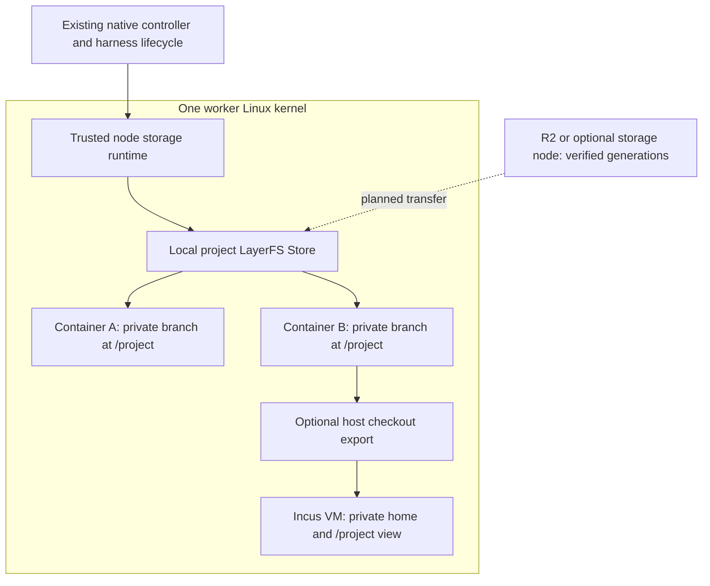

# LayerFS game workspaces

Owner decisions, October 23–24, 2026: use LayerFS for shared project state and private
agent workspaces. Engine Box combines
containers with LayerFS, manages compute and storage residency, and preserves
recoverable Store generations. Engine Box owns generic task/agent execution,
integration and merging, batched validation, evidence and promotion. Gamejam is an
application consuming these APIs and presenting game/community workflows. The target controller uses Cloudflare Workers/Durable
Objects, deployed in production or run locally with Wrangler for development/tests.
Every production bare-metal server is a managed compute and/or storage node. A dedicated storage
server is optional. One agent node may keep project storage local; execution across
multiple agent nodes requires shared storage, which R2 directly can supply.

The existing container integration is implemented. The independent [local fleet implementation #17](https://github.com/coop-collective/enginebox/pull/17) adds Wrangler/Compose, verified Store transport, cache eviction and protected candidate CI gates. The fleet now also executes operator-selected [same-Store logical integration](LOGICAL-INTEGRATION.md), protected Godot Web/Linux builds and recorded playtest review. Automatic batch composition, cross-Store import, native Unity/Unreal build qualification and production controller migration remain Engine Box work. See [the local development guide](LOCAL-FLEET.md), [integration/CI contract](INTEGRATION-CI.md) and [control-plane design](DESIGN.md#required-cloudflare-fleet-control-plane).
The [local development contract](DESIGN.md#local-development-and-test-fleets) keeps
Wrangler control state separate from the Linux LayerFS node's Store and task branches.

## Existing container integration

`packages/enginebox-storage-layerfs` already creates a LayerFS branch and Docker
sandbox, applies CPU/RAM limits, mounts the branch, and binds it at `/project`.
The runtime checks the Store volume, source/artifact bindings and container
identity before operations. Unprivileged agent commands receive the checkout;
the trusted helper and daemon own Store access. Provider homes remain private.
See [the backend contract](LAYERFS-BACKEND.md).

The [Incus adapter](LAYERFS-INCUS.md) exports the filesystem view through virtiofs;
the VM never opens the Store database. Direct Store openers stay on the host
kernel. An attached checkout has one VM writer, and host-side mutation is blocked
until clean stop/detach. Attached VM hibernation/snapshots are blocked because
external files are not captured with RAM or the VM disk. Automatic attachment
after [allocation preparation](LAYERFS-ALLOCATION.md) is still unfinished.

The shipped adapter pins preview `968a5d0be0ea3e9456b06f9148b65523138e9490`.
The separate v1.0.0 research uses `2aaf2552ce21154928b9f9c83582e41a637f5910`.
Their APIs differ. Container integration does not authorize silently swapping
the SDK or opening old Stores with an incompatible release.

## Applying the LayerFS ideas

The [upstream core ideas](https://layerfs.ai/docs/core-ideas/) guide the following
Engine Box contracts. These are applications to our workload, not new claims
that every upstream feature is already exposed by Engine Box.

| Idea | Engine Box application and current boundary |
|---|---|
| Short-lived compute | Headless tasks lease compute only when needed. Editor/play leases last across an interactive session. Existing sandboxes stay alive until explicitly closed; per-command scheduling is pending. |
| Distributed agents | Each worker has its own local Store. Containers there share its kernel. Network distribution exchanges consistent generations; no shared live SQLite database over NFS. |
| Parallel coordination | Private task branches; parallel work and candidate preparation; one authority updates the accepted head after checking its prior revision. Engine Box's integration queue is pending. |
| Forking earlier state | Reuse prepared checkpoints. `fork --from` already reuses a completed workspace checkpoint; arbitrary historical revision selection needs an explicit product API. |
| Deduplicated storage | Share committed content within a project Store. Measure database, WAL, overlays, transfer cache and generated data separately; do not multiply upstream benchmark ratios into capacity estimates. |
| Prepared startup | Preserve compatible dependencies and generated files. Existing pnpm reuse is qualified; engine cache identity and cold-to-play behavior still need qualification. |
| Checkpoints at work boundaries | The orchestrator must call `checkpoint` after a completed command/task before releasing its workspace. `exec` alone does not commit. Native harnesses remain unmodified; no claim that every native tool call is intercepted. |
| Immutable history | Pin exact revisions for tests and accepted artifacts. Archive verified Store generations before eviction. Append-only object history is not a power-loss durability guarantee. |
| Conflict policy | Refuse conflicting authored code/assets and expose repair. Any future `.lww` rules must be narrowly reviewed for regenerable outputs; never apply a blanket newest-wins rule to `.uasset`, maps or project source. |
| Small changes to large files | Exercise real engine saves, rename/rewrite behavior and delta size. Our 4 KiB synthetic overwrite proves storage behavior only; a full editor resave may rewrite much more. |

LayerFS's live Store currently requires local ext4, XFS or Btrfs and a shared
Linux kernel among its openers. It uses Disposable/WAL/synchronous=OFF and lacks
history GC. Consequently, archive publication and retention are explicit Engine
Box operations; local eviction removes a verified unused replica, not rows from
the only history database. [Upstream platform contract](https://layerfs.ai/docs/platform/).

## Source history and credentials

The game workflow targets LayerFS branches as its workspace history, with one
accepted revision authority. It does not add a second repository system.
Existing Git projects retain their Git integration semantics. The current
importer accepts reviewed committed Git trees; Git-free asset ingestion and
LayerFS candidate merge/publication are separate product additions. Never merge
independently modified `.git` internals as ordinary filesystem content.

Import only approved reusable files. Dependencies and derived caches may be
included after preparation, with their compatibility manifest. Do not turn
upstream's capture-of-ignored-files feature into copying provider homes, tokens,
private session databases or playtest footage into a shared project base.
Recordings remain separately retained artifacts referenced by task/build IDs.

## Delivery boundaries

1. Extend the existing pinned container backend: qualify the target LayerFS
   version, Git-free game ingestion, exact checkpoint identities and task-boundary
   commit/release behavior. Complete allocation/attachment without bypassing
   identity, capacity or guest readiness checks.
2. Add [Store distribution and cache residency](STORE-DISTRIBUTION.md): consistent
   snapshots, an authenticated manifest catalog, local hydration, recovery
   receipts and safe eviction. Connect to the required Cloudflare authority and
   qualify R2-direct operation without a dedicated storage node. Benchmark current
   and previous project generations.
3. Implement Engine Box's batched candidate checks and bounded engine pool. Test
   concurrent submissions, conflicts, stale promotion, native engine saves and
   compatible shader/import cache restoration. Cross-worker results require a
   logical change-import protocol; SQLite replica copying alone is insufficient.

## Integration queue and startup evidence

The optional dedicated storage nodes, warm node caches and lightweight agent
workspaces fit this split. The [Git-free Unreal probe](LAYERFS-VALIDATION.md)
also establishes that LayerFS has usable local history and merging. Keep the
accepted revision authority in Cloudflare. LayerFS is the selected workspace/history foundation;
Engine Box will distribute immutable Store generations and coordinate the accepted
head. The distributed adapter is specified in [Store distribution](STORE-DISTRIBUTION.md)
and is not implemented.

Inspecting Gitstalk main `785b66da` confirmed an existing integration pattern worth
adapting: parallel speculative preparation/checks, short serialized sprout updates,
asynchronous validation of immutable heads, and promotion of a validated prefix.
`v2-validator.ts` supports debouncing nearby landings into a shared validation;
`v2-check-reuse.ts` reuses a full passing check on the identical commit. The
debounce and evidence-promotion options are disabled by default in run config;
exact-commit full-check reuse defaults on. These are source findings, not a claim
that every option is deployed or enabled on a hosted repository.

The proposed Engine Box workflow is:

1. Agents edit private workspaces concurrently, usually without an engine process.
   A task submission records its base revision, exact changed content and intent.
2. The integration service combines compatible submissions into a sprout candidate.
   It preserves task dependencies and limits how much unvalidated work accumulates.
   Changes continue arriving while a verifier works on a frozen candidate.
3. A bounded engine pool performs the required compile/import, asset validation
   and playable smoke checks. One candidate build can cover several tasks, whose
   preview links record that same candidate revision. Isolated previews are a
   separate on-demand request and consume the same bounded capacity.
4. Promote only the checked candidate and its artifact to the validated/live
   channel, with a single publication authority and an expected previous revision.
   A newer sprout head is not covered by an older passing check. Failures keep the
   current live channel and return conflicting work for repair.
5. Refresh idle or checkpointed agent workspaces explicitly from an accepted
   revision. Updating files beneath an engine that is saving a project is not the
   default. LayerFS `branch.publish` alone cannot implement this workflow.

This preserves the integration policy without requiring Git to own every local
workspace. The Gitstalk implementation itself currently uses Git operations and
SHAs; a LayerFS adapter needs explicit revision, merge and publication
contracts. It is not a configuration-only substitution.

Gitstalk's optional test skipper was merged in PR #32. It selects Node test files
using restricted JS/TS import dependencies; the analyzer caps inputs at 16 MiB and
10,000 files/directories. It therefore does not cover Unreal or Unity assets.
Selected results cannot stand in for full validation or seed full-check reuse.
Its recorded paired benchmark showed a 1.11× median paired speedup in one CPU-heavy
scenario but lost to exact-commit reuse in every pair of that scenario: 9.21 s off versus 13.50 s on
for the separate medians. Reuse and skipping must be measured together.

For engines, begin with exact-input reuse and candidate batching. An engine test
selection adapter would need code/module dependencies, asset dependencies, importer
and build settings, engine/plugin versions, platform and check definitions. Unreal
[Asset Registry dependencies](https://dev.epicgames.com/documentation/unreal-engine/API/Runtime/AssetRegistry/IAssetRegistry/GetDependencies)
and Unity's
[asset dependency API](https://docs.unity3d.com/6000.0/Documentation/ScriptReference/AssetDatabase.GetDependencies.html)
can supply part of that graph; neither alone proves complete runtime dependency
coverage. Unknown/dynamic dependencies require broader checks. A shared material
can affect maps that no agent edited directly. The current Gitstalk flake heuristic
can treat different failing reruns as green; do not carry that heuristic into the
engine's final playable acceptance gate without a separate explicit policy.

For storage, a warm node forks an already prepared local revision. A cold node
fetches a verified Store generation, reconstructs it on its local supported
filesystem, registers fresh local runtime metadata, then mounts a private branch.
Keep preparation and engine readiness timings separate. The proposed chunk
transport in [Store distribution](STORE-DISTRIBUTION.md) reuses cached bytes;
it does not make a remotely backed SQLite file a supported live LayerFS Store.

Keep live SQLite stores local to their supported Linux kernel/filesystem. The
mesh should exchange verified immutable content and revision manifests, with
optional peer cache sources scoped to authorized projects. Peers are cache
providers, not independent authorities for the accepted head. Back up canonical
metadata together with reachable content to a separate failure domain; a storage
server and its backup directory on the same machine are not independent recovery.
Keep generated shader/import/build caches separate and disposable, with explicit
compatibility keys. None of this cross-node flow has been deployed or benchmarked
by the local storage probe.

## Initial deployment and generated caches

The owner approved using the existing Engine Box host for both execution and
storage during qualification. Separate OVH storage and GPU machines are a later
deployment choice, not a prerequisite for the prototype. Keep the service and
cache interfaces separable now, and label same-host measurements accordingly.
The current test host exposes only a management display adapter, so rendered
Unreal startup is measured separately on the local Mac, not claimed on that host.

A prepared workspace should reference an accepted source revision and a separate
cache manifest keyed by engine build, compiler/SDK, target OS/architecture/RHI, plugins,
import/build settings and relevant inputs. Preserve Unity's imported Library
and Unreal's reusable derived/build data in their correct storage scopes. The
Gamejam Unreal prototype currently reuses artifact-local binaries by build hash,
but its source hash excludes Saved/Intermediate/DerivedDataCache and the runtime
uses a host-level Zen DDC. Copying just the project does not back up that Zen cache.

Prepared VM disks or explicit cache bundles can avoid redoing compatible imports
without running a shared cache service. A local filesystem DDC is one testable
option; a Zen database needs its supported export/quiescence procedure, not a
copy of live database files. Keep installed engine DDC packs in the base image.
Treat project-local caches, host-level caches, driver/pipeline caches and process
RAM as distinct. macOS Metal cache/binary reuse does not establish Linux Vulkan
compatibility. Cache misses must rebuild correctly; source history remains the
authoritative recoverable content.

Measure source download, materialization, cache hydration, import/shader work,
engine readiness and first playable frame separately. Engine-ready alone is not
first playable frame. Cold tests must state whether installed engine DDC packs
are available, and whether only the project cache or every DDC tier starts empty.
Shared cache services remain an optimization to evaluate once multiple hosts
need incremental reuse; they are not required merely to preserve a prepared
single-host workspace. Do not advertise instantaneous cold restore from a local
copy-on-write clone result.

## Same-host Unreal storage baseline, October 23

The [machine-readable report](../research/storage-benchmarks/unreal-cold-load-results.json)
records a real 11,168,790,731-byte Unreal environment with 379 files, including
files up to 228,269,877 bytes. Both restored copies passed full SHA-256 manifests.
This is an archive/materialization baseline inside an admitted disposable Engine
Box VM, not a LayerFS transport implementation.

| Stage | Single observation |
|---|---:|
| Cold base VM readiness reported by Engine Box | 15.03 s |
| Fresh restore from already-seeded storage host, including guest fsync | 27.40 s |
| Verify every restored file | 10.25 s |
| Repeat extraction into another fresh directory, including fsync | 26.46 s |
| Verify every file in the second copy | 10.76 s |

Only the owned archive was advised out of the host's file cache before the first
restore; OS/device caches were otherwise uncontrolled. The repeat still writes
all content and is not a warm workspace fork or editor resume. Local archive
hydration was much faster than WAN seeding: the initial sequential transfer was
changed after 1,314 seconds, retaining a checksum-verified 5.97 GB prefix. Four
connections then transferred the remaining 5.16 GB in 643 seconds. This changed
treatment is not a controlled throughput comparison. The full archive checksum
matched after assembly. Zstd level 1 reduced 11.17 GB to only 11.12 GB; these
already-compressed assets need reuse/deltas, not an assumption of large archive
compression savings.

The guest had 4 vCPU and 8 GiB RAM. Its Incus root device was configured as 80 GiB,
but the mounted guest filesystem was only 31,043,616,768 bytes. The two copies
fit with the required free-space reserve; this exposes a capacity-readiness gap
to fix before allocating larger game projects. Verify usable guest filesystem
capacity, not just the declared volume size.

Private source, manifests and logs remain outside Git. The disposable VM and
duplicate upload fragments were removed. The verified 11.12 GB archive remains
privately on the existing storage host to avoid another WAN seed for follow-up
tests; it is a reusable fixture cache, not an independent backup. Rendered
startup, complete shader-cache preparation, and restored-cache reuse remain
unqualified and must not be inferred from these file-copy timings.

The native probe copied and hashed the full 20.66 GB Content tree, while targeting
the environment's asset-zoo map for cache preparation. Render-capable DDC runs
hit a 900-second deadline during initial shader work. A separate headless run
exposed an incorrect `/Game/...` map argument in the harness: this commandlet
expects a relative Content filename. The corrected headless run selected the
map but still hit its 300-second limit before processing it. UE 5.8's commandlet
explicitly compiles target-platform global shaders before loading packages,
including under NullRHI. Headless does not eliminate that preparation cost.

All attempts, including the map-argument failure and deliberate diagnostic stop,
remain in the report. The harness now requires the map's processing log as well
as successful exit; an empty successful commandlet cannot count as qualification.
No cold-fill success, warm-fill speedup, generated-cache restore benefit or
first-playable-frame timing was established. Complete those measurements on the
intended engine/toolchain/platform before promising fast editor startup.

## Checksum follow-up and startup overlap

The [October 23 comparison](../research/storage-benchmarks/unreal-verified-restore-results.json)
reused the already-seeded 11.17 GB environment in a fresh 4-vCPU, 8-GiB disposable
VM. One-worker read-back took 9.21–10.86 s; four workers took 2.59–2.84 s. All eight
full-file SHA-256 audits passed. Across these observations, median verification
time fell from 10.46 s to 2.72 s (about 3.8×). This supports a **bounded parallel
verifier**, not removing integrity checks. Cache state is uncontrolled and this
small sample does not establish production percentiles or physical-media checks.

Extraction plus guest sync took 28.05 s. Adding the first serial verification
gave 37.26 s; adding the first four-worker audit would give about 30.64 s. The
latter is a component-time estimate, not a separately measured end-to-end run.
Thus the checksum gain removes roughly seven seconds here, not three quarters
of total restore time. The initial inline SHA-256 extractor took 64.62 s and
passed integrity checks, but was slower; serial extraction/hashing and per-file
fsync need separate investigation before recommending that implementation.

For the product integration, overlap independent preparation first:

1. Boot/admit the VM and prepare trusted engine binaries or reusable cache layers
   while source content is fetched and verified. Project scripts/plugins stay
   behind the project integrity gate. Reusing a prewarmed process is engine-
   specific and still needs qualification.
2. Verify a complete immutable base once for its revision and storage generation,
   then let authorized agents fork it. Do not run 100 identical full scans merely
   because 100 agents start. Invalidation, corruption or untrusted cache sources
   require revalidation; cache receipts must not outlive their content identity.
3. After every required file and the producer exit pass, allow project startup.
   A later independent audit may overlap startup only under an explicit policy
   that accepts ingress verification first. Audit the immutable base while the
   engine writes its own fork. A failed audit invalidates dependent work and
   prevents acceptance/promotion.
4. To load a project before *all* files arrive, build a filesystem gate that checks
   each chunk/file before the engine can read it. Ordinary extraction plus a
   background checksum task does not provide that guarantee. Neither this
   research helper nor the deployed provider implements that gate.

The measured recommendation is four-worker read-back before project access,
with host-wide limits to avoid competing scans. No actual engine-start overlap,
first-frame improvement or product provider change was demonstrated by this
checksum experiment. Startup/cache qualification remains an independent gate.
