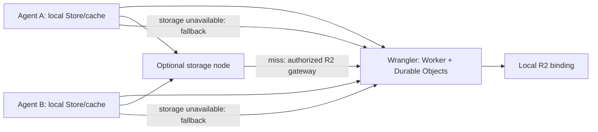

# Local Cloudflare fleet and project storage

This is the development implementation of the selected Cloudflare fleet design. It runs the Worker, SQLite Durable Objects, local R2, two agent nodes and an optional storage node on one computer. Cloudflare owns fleet state; nodes own local execution and disposable caches. Production uses the same Worker code with real Cloudflare bindings.

The deployed Rust controller, provider connections, Incus workspaces and Gamejam engine sessions have **not** been migrated. This stack implements the shared Store transport and job authority. It does not bundle an engine, automatically import a restored Store into the pinned LayerFS runtime, or establish a public multi-tenant service. Native LayerFS execution has an explicitly configured adapter described below.

## Start and iterate

Install Node **24+**, pnpm **12.14.0**, and Docker with Compose v2. Docker Desktop must use **Linux containers** on macOS and Windows; WSL2 is the Windows path. Linux can use Docker Engine with the Compose plugin. The pinned image supports both Linux amd64 and arm64. No Cloudflare account, login or API token is required for local development.

```sh
pnpm install --frozen-lockfile
pnpm fleet:dev --storage
pnpm fleet:status
pnpm fleet:fixture
pnpm fleet:logs
pnpm fleet:down
```

`fleet:dev` creates a private owner token and independently scoped node credentials, starts Wrangler, enrolls `agent-a`, `agent-b` and `storage`, and starts the selected services. Omit `--storage` for two nodes sharing only the R2 emulator. Omitting the flag does not stop an already running storage node. The controller health URL is **http://127.0.0.1:8799/health**; authenticated inventory is available through `fleet:status`. This is an API development stack, not the existing dashboard.

`fleet:fixture` creates, publishes and queues verification of a synthetic SQLite snapshot. Publication retains a candidate generation; acceptance is a separate compare-and-swap operation. It does not silently update the accepted project head. To publish an existing **closed, consistent** Store backup:

```sh
pnpm fleet:publish /path/to/backup.sqlite
pnpm fleet:verify GENERATION_SHA256
pnpm fleet:accept GENERATION_SHA256
```

`fleet:verify` waits for the verification job and reports its node and elapsed time. `fleet:accept` explicitly advances the local demo project head after checking the generation parent; it is separate from publication and verification.

The launcher copies that backup into its owned container, uses SQLite Online Backup to stage a consistent database, publishes it, then removes only its copied input. Do not use this command to copy the main file of a running SQLite database without its WAL. A node-local caller of `publishSnapshot` can back up a live Store on its own Linux filesystem using the Online Backup API; the test suite verifies committed WAL data is included.

Source files are mounted read-only into the containers. Wrangler reloads controller edits; Node's watch mode restarts node code. Re-run `fleet:dev` after changing dependencies, configuration or the Dockerfile. The launcher uses Node and argument arrays, so the commands work in PowerShell and Unix shells without Bash wrappers.

Local configuration lives in `.state/fleet-dev/`; Store files and Wrangler state live in distinct **Docker named volumes**, on the Linux VM's filesystem. `fleet:down` removes this stack's containers/network and preserves its volumes and private credentials. It never prunes Docker resources. Re-running `fleet:dev` reconnects to the same state. Keep the private configuration and controller volume together: losing an enrollment token requires explicit re-enrollment under a new node ID, not silently adopting an existing node.

Use `EBOX_FLEET_STATE` for a second independent local fleet and `EBOX_FLEET_PORT` for its host port. Compose names derive from the absolute state directory, so another worktree gets a separate fleet. In PowerShell set `$env:EBOX_FLEET_PORT = '8800'`; in a Unix shell use `export EBOX_FLEET_PORT=8800`. The smoke test always chooses its own new state directory and uses port 18879 by default.

## What runs where



| Component | Current role |
|---|---|
| `packages/fleet-controller` | Owner/node authentication, project heads, durable acceptance records, node sessions, job reservations and leases; streaming R2 gateway |
| `packages/fleet-node` | Consistent snapshot publication, local chunk and snapshot caches, verification, storage read-through service, job journal and optional native adapter |
| `packages/fleet-protocol` | Versioned manifests, validation, bounded chunks and deterministic identifiers |
| `packages/fleet-dev` | Cross-platform launcher, Compose topology, isolated smoke test |

One node can still use the existing local LayerFS backend without shared transport. Two or more nodes sharing project generations require a shared object service; R2 is sufficient. A dedicated storage server is optional. Compute and storage roles may run on the same physical server with separate private state directories. Different nodes never open the same writable SQLite file over NFS or replicate its WAL as a merge protocol.

LayerFS's live Store remains subject to its Linux, supported-filesystem and same-kernel contract. A Linux named volume is appropriate; a macOS/Windows host-directory bind mount is not the Store location. Source-code bind mounts in this Compose file contain code only. See the [existing pinned backend requirements](LAYERFS-BACKEND.md) and [upstream core ideas](https://layerfs.ai/docs/core-ideas/).

## Publication, reads and recovery

1. A publisher obtains a consistent SQLite backup and verifies SQLite integrity and foreign keys.
2. It hashes and uploads bounded 4 MiB chunks. Existing content-addressed chunks are reused. The controller accepts at most 8 MiB per chunk and validates its SHA-256.
3. Index pages reference at most 256 chunks. The controller checks every referenced chunk's durable receipt before accepting a page, then checks every page before publishing a generation. A generation is an immutable candidate, with an explicit parent.
4. Acceptance requires the expected current head and a generation based on it. The Project Durable Object writes its decision to R2 before acknowledging the new head. Competing accepts fail; they require integration and a new generation. Publication itself does not merge changes into other workspaces.
5. A reader verifies manifests and each chunk, writes a private temporary snapshot, verifies the whole digest and SQLite integrity, then atomically installs it. Hashing happens during assembly, avoiding a separate post-download whole-file hashing pass. A warm existing snapshot is verified before reuse.

The read order is **node-local cache → registered storage node → R2 gateway**. A storage miss fetches and verifies the R2 object, caches it, then serves it. Concurrent requests for the same chunk share one fetch. Storage origins use short-lived generation-scoped transfer grants; revoked or stale nodes stop receiving new routes. A failed, slow or corrupt peer response falls back to R2. In this implementation R2 traffic passes through the authenticated Worker; direct presigned R2 URLs are a future optimization, not a current dependency.

A storage node can start empty and serve misses immediately. Its background warmer prefers the accepted generation, then recent candidates. It advertises readiness only after verifying a complete retained generation, and keeps it pinned while advertised. The initial policy warms one fitting generation per project and reserves cache headroom; oversized projects remain available through read-through caching. Losing that node does not lose published content. Rebuild it with fresh local state, enroll it, and let reads/warmup repopulate it from R2. There is no copying of another node's live metadata database and no global promotion of an incompletely populated disk.

`cacheBytes` bounds chunk storage. Eviction begins around 80% and targets 65%, excluding pinned/in-flight chunks and retaining a filesystem reserve. `snapshotBytes` separately bounds immutable hydrated snapshots (default: four times the chunk budget); inactive snapshots are evicted oldest first. A snapshot can exceed its chunk-cache budget. Active writable LayerFS Stores and unpublished work never enter either eviction namespace. An oversized request fails visibly rather than deleting writable project data. Interrupted chunk transfers retry by hash; snapshot assembly reuses verified cached chunks and rebuilds its temporary database.

R2 objects are retained indefinitely in this first implementation. Do not add bucket lifecycle deletion to the protected object prefix: manifests and accepted decision records depend on retained chunks. Storage-node reconstruction is implemented; destruction/reconstruction of the Cloudflare authority, R2 retention garbage collection, independent backups and regional disaster-recovery drills remain separate qualification work. RAID does not replace those backups.

## Jobs and the native runtime boundary

Enginebox owns the generic agent/task, integration and CI workflow. Gamejam consumes it as an application. See [integration and CI](INTEGRATION-CI.md) for the Beanstalk mapping and implemented candidate gate: protected recipes, immutable batch membership, full-check evidence, and stale-promotion rejection. Configure project checks to require a validated candidate at acceptance; the plain storage service remains usable without a CI provider.

[Project tasks and native MCP tools](TASK-WORKFLOW.md) add durable idea/issue records, chat-to-task references, revision-guarded edits/moves, audit history and evidence-gated shipping. The same API serves the app adapter and native Codex. The smoke test exercises real scoped MCP calls against this local controller.

The owner queues `hydrate`, `verify`, or explicitly configured `layerfs-exec` jobs against immutable generations. Nodes pull work; the controller reserves node capacity and records an attempt before dispatch. Leases last 30 seconds and renew while work runs. Node restarts change the session epoch. A local watchdog cancels an expired native invocation independently of a slow controller HTTP request.

Node-local journal records survive process restarts. A completed attempt resends its recorded result; it does not replay the command. Interrupted read/verify attempts can be reconciled as failed and submitted again under a new job ID. Interrupted native commands retain their reservation and require owner reconciliation after inspecting/stopping the executor. Killing the CLI process alone is not proof that its container command stopped; the existing Rust backend's bounded command/recovery receipts remain relevant.

The optional node configuration `layerfs` contains an `ebox` executable, its pinned backend `config`, and project bindings `{project, workspace, generation}`. The native adapter refuses generations without an explicitly qualified local base, forks a private workspace through `ebox`, runs the bounded argument vector, and checkpoints it. Default Compose nodes have no such binding and no Docker socket; they run transport/verification tasks. Automatic cold import into the pinned LayerFS SDK, qualification of native agents on those imports, and engine/editor startup are **not enabled by a successful SQLite transport test**. This separation prevents an unverified or incompatible Store from being mounted into a live editor.

## API and debugging

All routes except `/health` require Bearer authorization. Owner credentials can register scoped nodes, publish, enqueue and accept. Agent credentials can publish/read their assigned projects; storage credentials can read and report readiness. Transfer grants are scoped to one generation. Do not copy owner credentials into agent workspaces.

| Route | Purpose |
|---|---|
| `POST /v1/projects` with `{id}` | Create a project |
| `POST /v1/nodes` | Enroll a node; token returned once |
| `GET /v1/nodes` | Inventory, epochs, readiness and cache statistics |
| `GET /v1/projects/:project` | Head, recent 32 generations plus accepted head, recent 256 jobs |
| `POST /v1/projects/:project/jobs` | Queue `{id, project, generation, kind}`; native commands add `argv` and `timeoutSeconds` |
| `GET /v1/projects/:project/jobs/:id` | Retrieve a particular durable job, including older jobs; `result` is serialized JSON |
| `POST /v1/projects/:project/accept` | Accept `{generation, expected, candidate?}` using compare-and-swap; candidate is required when checks are configured |
| `POST /v1/projects/:project/checks` | Owner configures protected required checks; empty list keeps storage-only acceptance |
| `POST /v1/projects/:project/candidates` | Stage immutable batch membership against an integrated generation and base |
| `GET /v1/projects/:project/candidates/:id` | Read frozen requirements and current qualifying full-job identities |
| `POST /v1/nodes/:node/revoke` | Revoke credentials and future routing |
| `POST /v1/nodes/:node/reconcile` | Owner confirms `{assignment, stopped:true}` after stopping/inspecting an uncertain executor |

Node logs are structured JSON; `fleet:logs agent-b` narrows the stream. Check `connected`, node epoch, `activeJobs`, `originFetches`, `peerFetches`, `peerFailures`, `repairs`, `evictedBytes` and generation readiness. Metrics arrive on the next heartbeat, so completion can precede its counters. Wrangler logs show the corresponding API calls. Node state files include `cache.sqlite`, `operations.sqlite`, verified chunks and immutable generation snapshots.

For controller-only debugging on the host, create a private `packages/fleet-controller/.dev.vars` containing an independently generated `ADMIN_TOKEN`, then run `pnpm --filter @enginebox/fleet-controller dev --persist-to .state/local`. This starts a separate controller with its own DO/R2 state. Nodes must be explicitly enrolled with its reachable URL; it is not automatically connected to the Compose fleet. The normal all-in-Compose launcher avoids host-gateway and Windows path differences.

Existing development entry points retain their roles: Enginebox `pnpm dev` starts the dashboard, `pnpm dev:site` starts the product site, and the Rust controller/node use their documented launchers. Gamejam's `prototype` room launcher and `platform` multi-service launcher are separate applications. `fleet:dev` adds a reproducible storage/control-plane environment; it does not restart those services.

## Verification and release gates

```sh
pnpm check:fleet
pnpm test:fleet
pnpm fleet:smoke
```

The smoke test builds an isolated Compose project, publishes from one node, restores on another, passes the configured full candidate check, verifies storage reads and readiness, stops storage to exercise R2 fallback, and restarts Wrangler to verify the accepted head persists. It then enrolls a replacement storage node with an empty named volume and verifies that R2 rebuilds the accepted generation. The original storage node stays stopped during that recovery. Its finalizer removes only that test's uniquely named containers and volumes. Normal development state is preserved. Unit/runtime tests exercise scope/revocation, missing chunks, conflicting accepts, stale results, coalescing, corrupt-cache repair, pinned capacity, snapshot-index crash recovery, WAL backup and a snapshot larger than cache capacity.

The same smoke also enrolls a dedicated assistant node and dispatches a real Cloudflare job through `runNode` to a test-only native HTTP executor on an ephemeral host loopback port. That fixture invokes the official MCP client and scoped task server against Wrangler, then emits a native Codex JSON message. The smoke checks the durable assignment, assistant response, persisted task mutations, audit identity and idempotent dispatch. Its host SQLite files contain node metadata only; no Store is hydrated. Temporary node files and fixture processes are cleaned up before storage checks continue. This verifies the integration path without live model inference, an Incus workspace, a LayerFS mount or changes to an existing Codex profile; the final report explicitly includes `liveInference:false`.

The local end-to-end stack has been exercised on macOS with Docker Desktop's Linux arm64 VM. The CI matrix runs Node/Worker tests on Linux, macOS and Windows, with the Compose smoke on Linux. Native Windows/macOS LayerFS mounting is not claimed. Production rollout additionally requires real R2/network failure tests, retention/rebuild drills, the native runtime import/engine gates above, bounded fleet discovery at larger scale and migration of legacy controller/private state. No production controller cutover is performed by these commands.

Wrangler 4.152.0 and workerd 1.20261019.1 are pinned; compatibility date 2026-10-19 matches the bundled runtime's supported date. Local bindings and persistence follow [Cloudflare local development](https://developers.cloudflare.com/workers/local-development/) and [local data](https://developers.cloudflare.com/workers/local-development/local-data/).

A local transport observation on October 24 used the existing **631,517,184-byte Unreal/LayerFS SQLite backup**, 151 chunks, a 256 MiB node chunk budget and a 1 GiB snapshot budget. Queue-to-verified completion was **12.24 s** on an empty agent cache; two repeats using the retained snapshot were **2.39 s** and **1.83 s**. Whole-file SHA-256 and SQLite integrity/foreign-key checks passed. These are individual local Docker/R2-emulator observations with normal OS caches and concurrent development activity, not remote throughput percentiles, native LayerFS reopening or engine first-frame measurements. The private database and raw receipts are excluded from Git.
