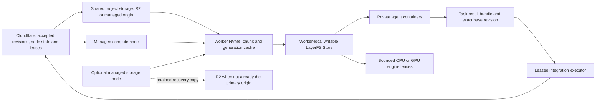

# Project Store distribution and worker disk management

Decision, October 23, 2026: keep LayerFS as the project workspace/history system.
The required fleet controller uses Cloudflare Workers/Durable Objects, deployed
in production or run locally with Wrangler for development/tests. Every production
bare-metal server is a managed node. Workers use local NVMe for active projects,
agent containers and engine caches.
A dedicated storage server is optional. Shared project storage, supplied by R2
directly or an R2-backed managed origin in production, is required across two or more agent
nodes. One node may use local-only project storage; a node may combine compute
and storage roles. Distribution, cache eviction and cross-worker integration are
proposed capabilities;
the existing container backend is described in [game workspaces](GAME-WORKSPACES.md).

## Proposed technology choice

October 24 implementation update: [draft #17](https://github.com/coop-collective/enginebox/pull/17) implements SQLite Online Backup, bounded content-addressed 4 MiB chunks, a Worker/R2 gateway and reconstructible storage caches in the local Wrangler/Compose fleet. The desync work below remains a measured comparison and a possible adapter after qualification; it is not a dependency of that first implementation. Logical cross-worker integration and native engine startup remain separate gates.

Qualify **SQLite's Online Backup API plus desync v1.1.5** first: obtain a consistent
closed snapshot, publish its chunk index once, and let workers reconstruct it
using local chunks or a previous verified snapshot as a seed. A private HTTP
origin is sufficient for transfer qualification; it is an optional deployment role.
Qualify an R2-direct adapter so multi-node execution needs no dedicated storage
machine. No second source-control system is needed for this transfer path.

| Technology | Useful role | Decision and boundary |
|---|---|---|
| SQLite Online Backup API | Consistent snapshot of committed database state | Initial capture primitive; include required LayerFS discovery metadata in a versioned bundle. Never independently copy a live database and WAL. [SQLite](https://sqlite.org/backup.html) |
| desync / casync | Immutable large-file distribution, chunk reuse and local caches | Preferred fleet-distribution candidate. desync exposes parallel transfer, seeds and cache chaining. Qualify its pinned release on actual Store generations. [desync](https://github.com/folbricht/desync/tree/v1.1.5) |
| `sqlite3_rsync` | SQLite-aware, page-difference copy over SSH | Simpler two-machine comparison baseline. It creates a consistent replica, but does not supply project catalogs, retention or bidirectional history merging. Its database header may differ; a whole-file hash is not its equivalence test. [SQLite remote copy](https://sqlite.org/rsync.html) |
| restic | Encrypted retained backups with deduplication | Candidate for a separate recovery copy, not the active filesystem. SFTP can use the existing server; later move the recovery copy to a separate failure domain. [Backends](https://restic.readthedocs.io/en/stable/030_preparing_a_new_repo.html), [retention](https://restic.readthedocs.io/en/stable/060_forget.html) |
| Kopia | Alternative snapshot, encryption and retention stack | Consider instead of restic if its policy/server features simplify operations; avoid deploying both. It does not manage LayerFS workspace leases. [Features](https://kopia.io/docs/features/) |
| Litestream | Continuous SQLite WAL replication for recovery | Later option for reducing the loss window. Its checkpoint interaction with LayerFS's pinned profile needs qualification. Async backup is not accepted-head synchronization. [Mechanism](https://litestream.io/how-it-works/) |
| LiteFS | Primary/replica SQLite service | Poor fit for independent writable worker Stores: replicas do not accept writes, and LayerFS currently restricts backing filesystems to local ext4/XFS/Btrfs. [Write model](https://www.fly.io/docs/litefs/primary/), [LayerFS contract](https://layerfs.ai/docs/platform/) |

The transfer implementation needs a snapshot publisher, a shared chunk destination
and an Engine Box worker cache manager, controlled by the required Cloudflare
fleet service. Backup software is a
separate retention/recovery choice. Neither desync nor SQLite replication replaces
LayerFS history or supplies the task acceptance queue.

## Storage and compute topology

Cloudflare Workers and Durable Objects own fleet authority as specified in the
[control-plane design](DESIGN.md#required-cloudflare-fleet-control-plane).
Storage optionality concerns project bytes and node roles, not control state.

| Deployment | Project storage requirement | Dedicated storage node |
|---|---|---|
| One agent node, including multiple agent containers | Local LayerFS Store is sufficient for editing; remote storage is optional until recovery/promotion guarantees are requested | Optional |
| Two or more agent nodes executing the same project | Shared service retaining authenticated generations and required chunks; R2 alone qualifies once the adapter passes qualification | Optional |
| Larger fleet with nearby origins | Shared service plus managed replicas/site caches to improve throughput and recovery | Optional performance/capacity role |
| Two-node local integration test | One reachable development object service with a local R2 simulation, or an isolated real R2 bucket | None required; simulated storage is not an independent backup |

Here a node is a separate worker machine/kernel, not an agent process. Two machines
can technically run unrelated projects without shared project storage; the
requirement applies to our shared-project distribution and recovery contract.
Allow node enrollment before storage setup, but block cross-node project placement
until the shared backend is configured, authorized and ready. Loss of readiness
blocks new transfers/promotion, not deletion of local work. Local-only mode must
show that losing its node can lose project data; Cloudflare metadata cannot
reconstruct absent project bytes. The off-host acceptance gate below still applies.

### What a configured shared service means

A shared service is an object-transfer endpoint plus an authorization, generation
and retention contract. It is not a shared mount of the live LayerFS database, and
it does not imply a dedicated physical server. The minimum R2-direct deployment is
the Cloudflare controller, an R2 bucket and two compute nodes with local Stores.

Configuration/readiness requires:

1. A selected environment/bucket and project/trust namespaces, with every intended
   node able to reach the object-transfer endpoint. Test resources must be explicit.
2. A controller R2 binding or narrowly scoped service credential, plus authorized
   node transfer access. A Worker binding alone does not give an external node S3
   access. Use short-lived operation URLs or scoped temporary credentials through
   the controller; never send bucket-admin credentials to agent containers.
   [Presigned URLs](https://developers.cloudflare.com/r2/api/s3/presigned-urls/),
   [temporary credentials](https://developers.cloudflare.com/r2/api/s3/temporary-credentials/).
3. Authenticated generation manifests, chunk identities and upload-completion
   receipts, with retention/pins and recoverability checks before eviction or
   promotion. Cloudflare retains the accepted-head authority.
4. A working node adapter that publishes from node A and reconstructs/verifies the
   exact generation on node B from empty local storage. Merely creating a bucket
   or writing a binding in a config does not establish readiness.

For local tests, a Worker development route can expose authorized chunk/manifest
HTTP operations through one simulated R2 binding. This is a proposed development
adapter; do not assume Wrangler exposes a production-compatible S3 endpoint to
external clients. Nodes use that service API, never its local persistence files.
Two independent R2 simulations on different nodes do not form one shared store.
Alternatively use an isolated real R2 bucket with the local controller to qualify
the actual transfer path. Local versus remote bindings must be explicit.
[Development binding support](https://developers.cloudflare.com/workers/local-development/bindings-per-env/).

The simulated service tests sharing, not independent durability: a local-only
fixture cannot satisfy production's off-host acceptance requirement. Keep simulated
test results visibly separate from production-ready acceptance receipts.

Use separate Store volumes per project/trust boundary, as the existing backend
does. A worker's agent containers share a local Store; a different worker gets
a distinct local Store. Raw backing files are never exposed to agent commands.
An Incus VM may receive the existing host-mounted checkout export, but never the
Store itself. Worker admission counts the container/helper overhead, optional VM,
engine CPU/RAM/GPU and storage commitments together.

The storage role favors capacity and network throughput; workers favor local
I/O and their workload's compute. Put catalog/index metadata and frequently
requested chunks on fast storage where available, but measure before adding a
second cache service. Initially keep role directories and quotas distinct on the
existing machine. A second directory on that machine is not an independent
backup; its loss can remove both roles. Neither role hosts authoritative fleet
state: Cloudflare remains the controller even for this combined-node deployment.

## Resilience and rebuilding a lost server

This is an optional Engine Box distribution/recovery layer around local LayerFS,
not an upstream distributed SQLite mode. LayerFS's current contract requires
every Store opener to share one Linux kernel and supported local storage. Its
decentralized-agent concept does not currently provide cross-server replication,
consensus or automatic failover. [Current contract](https://layerfs.ai/docs/core-ideas/).

Use three distinct protections:

| Protection | Purpose | Boundary |
|---|---|---|
| RAID10 on the storage host | Continue through tolerated disk failures and replace failed drives | Does not survive losing the host/site or preserve an earlier version after deletion; does not fix LayerFS's current power-loss durability limitation |
| Replicated immutable generations on another storage host | Serve projects promptly after a host outage | Hosts must be separate failure domains; two directories or VMs on one machine do not qualify |
| Retained generations in R2 | Rebuild after losing the storage fleet, or recover an earlier retained revision | Requires complete manifests, referenced chunks and recovery metadata; availability and recovery time still depend on the remote service/network |

For recoverable/shared operation, start with the existing combined compute/storage
node plus R2 Standard, or use R2 directly without running a separate origin service.
Local-only single-node editing is the explicitly less durable option above.
Later add a second storage origin with a complete
copy of the retained project generations it serves, preferably outside the first
host's site. Workers may fetch verified chunks from either origin or authorized
peers. Worker residency is opportunistic and never counts as the sole durable copy.
R2 stores redundant data across several data centers within a geographic region;
this does not promise cross-region availability. [R2 durability](https://developers.cloudflare.com/r2/reference/durability/).

Initially replicate each required chunk instead of spreading unique chunks across
servers: losing one server must not make every snapshot that referenced its chunks
unreadable. If capacity later requires sharding, use an established object backend
with replication or erasure coding across host failure domains, a repair process
and measured degraded reads. Do not implement a custom distributed RAID protocol
inside the LayerFS adapter. Keep transport and origin selection independent of the
local workspace API so a single-node installation does not require storage peers.
Its fleet controller still uses the Cloudflare architecture, with local Wrangler
permitted for development/tests as specified in [the design](DESIGN.md#local-development-and-test-fleets).

### Warming a storage node and making it the preferred origin

In the production R2-backed mode, a storage node becomes the preferred **read
origin** for verified project generations. Cloudflare keeps fleet/revision
authority, and R2 keeps the retained durable content needed to rebuild the node.
Read preference never authorizes accepting a revision whose required R2 objects
and acceptance record are absent. A node can begin serving active projects while
older retained generations are still downloading.

1. **Enroll and inventory.** Register the node's identity, supported format,
   capacity and endpoint with Cloudflare. Reconcile any surviving local inventory;
   only verified content is reusable. Begin in `warming`, without advertising
   complete project replicas. R2 continues serving the existing read path.
2. **Capture the assigned scope.** Cloudflare supplies authenticated manifests for
   the node's assigned projects, retention pins and a durable catalog cursor.
   Subscribe to later publication changes and periodically reconcile the catalog;
   notifications are hints, not the sole record of what needs copying. The cursor
   and assignments are scoped rather than one global fleet synchronization lock.
3. **Fetch useful data first.** Prioritize active accepted/candidate generations,
   upcoming tasks and compatible expensive caches, then pinned rollback/history.
   Fetch missing chunks from R2 or an authorized healthy replica. Coalesce repeated
   demand for the same chunk; journal verified progress so a restart resumes.
   Bound bandwidth, concurrency and disk reservations so backfill yields to agent
   reads and current-generation replication. A node without enough capacity stays
   partial or receives a smaller assignment; it never claims complete residency.
4. **Verify and advertise each generation.** Download into owned staging files,
   verify digests against the authenticated manifest and atomically install complete
   chunks. Retain the generation's pins. Report readiness only after its manifest,
   index and every required chunk are present and local persistence is acknowledged.
   Cloudflare binds the receipt to the exact generation, node session and format;
   a percentage-complete download or heartbeat is not a readiness receipt.
5. **Shift reads gradually.** Cloudflare issues versioned endpoint preferences per
   project/generation. Try a bounded share of requests, check latency, corruption,
   misses and errors, then prefer the node for that generation. Other generations
   keep using R2 until ready. Clients cache authorized routing information, retain
   bounded timeouts and verify content; they do not need a control-plane call for
   every chunk. This changes future transfers, not running engines or local Stores.
6. **Keep following new work.** Publish durable new content to R2 first, then enqueue
   replication to assigned storage nodes. Until a node verifies the new generation,
   that generation uses R2; the prior verified generation remains valid for its
   exact revision. A caught-up catalog cursor describes a point in time, not a
   permanent promise that all future revisions are already local.

The normal read order is worker-local verified cache, a ready preferred storage
node, another authorized replica, then R2. A timeout, missing chunk or digest
failure triggers bounded fallback for that request and a repair report; Cloudflare
can reduce or remove the node's routing preference. A stale route cannot silently
substitute an older generation. During initial warmup, bypass known-incomplete
generations instead of adding a storage-node miss to every R2 request.

Replication uses retained manifest roots, not a blind copy of every object in the
bucket. Coordinate hydration pins and remote GC so required chunks cannot expire
mid-copy. Track verified bytes, missing bytes, ready generation IDs, catalog lag,
hit rate and foreground latency. Separate `warming`, `serving selected generations`,
`caught up to cursor` and `degraded`; there is no fleet-wide primary switch or
requirement to copy the entire archive before serving the first project.

R2's read-after-write consistency supports fetching successfully published objects,
but the chunk/manifest/catalog publication protocol still needs its own receipts
and retry handling. [R2 consistency](https://developers.cloudflare.com/r2/reference/consistency/).
This warmup, routing and repair behavior is proposed Engine Box functionality,
not a shipped LayerFS or Cloudflare fleet feature.

The R2 path should transfer only missing content-addressed chunks while retaining
a complete index for each generation. A restore follows that index directly; it
does not replay every earlier snapshot. Upload referenced objects before exposing
the manifest. Deduplication belongs within an authorized project/trust domain.
This is a proposed publication protocol, not a qualified desync-to-R2 integration.
Qualify direct R2 object transport for this shared-origin and fallback path. A
restic-managed backup may be an additional recovery option; it must not be the
only copy if the node adapter cannot directly reconstruct the advertised generations
from it. Avoid maintaining two backup catalogs without a demonstrated need.

R2 Standard currently charges $0.015/GB-month plus operations, with no Internet
egress or retrieval fee. One TB (1,000 GB) is about $15/month for storage before
free allowances and operations. Small objects increase request counts; our 632 MB
loopback fixture needed 9,544 chunk GETs. Measure remote latency and request cost
before choosing larger transfer chunks or immutable packs. Neither packing nor
efficient incremental transfer across real engine saves has been qualified.
[R2 pricing](https://developers.cloudflare.com/r2/pricing/).

Retain authored assets, source/history, exact candidate/test references, manifests
and accepted-head decision records. Back up controller desired state and pinned
installation recipes separately; keep necessary recovery keys accessible outside
the lost host in private operator custody. Never put native provider credentials
in a shared project generation. Keep selected compatible engine/shader cache
bundles to shorten recovery, with separate bounded retention; their loss may make
a rebuild slow but must not make the project unrecoverable.

Use unique immutable generation names and bucket lock rules for the retained
recovery objects. Separate uploader access from retention/deletion administration.
R2 lock rules can be removed by authorized administrators, so they are not an
absolute defense against account compromise. Do not expire shared chunks based
only on object age: an old chunk can still be required by a new retained manifest.
GC must check all retained roots and lock requirements. [Bucket locks](https://developers.cloudflare.com/r2/buckets/bucket-locks/).

The proposed acceptance contract requires an off-host durable copy of all required
objects **and the accepted-head decision record** before acknowledging acceptance
or shipping. Recovering accepted work after one host loss should then have a zero
loss window for acknowledged revisions; this remains an implementation and drill
requirement, not a current guarantee. If off-host publication is unavailable, keep
working locally where authorized, but leave promotion pending. For in-progress
work, target upload within one minute of a safe committed file checkpoint and
report actual lag. Uncommitted overlays, engine RAM and changes made during an
upload can still be lost; the target is not a guarantee for every editor action.

Rebuild in this order:

1. Provision a compatible clean node from pinned recipes and enroll it with the
   existing Cloudflare controller. Losing a bare-metal node does not lose the fleet
   catalog or acceptance records. The node receives authorized desired state.
2. Cloudflare fences the previous node/integration attempt before issuing
   conflicting leases. Reconcile uncertain jobs; a missing heartbeat never proves
   the old writer is stopped. Storage replicas never elect a fleet controller.
3. Restore the exact required generation from the surviving origin or R2 onto
   local supported storage. Verify digests, SQLite integrity, LayerFS reopening
   and project file manifests before activation.
4. Restore compatible optional caches and start a bounded engine lease. Prioritize
   active projects; rebuild remaining origin data in the background. Full Store
   hydration remains required before opening that Store.

Measure recovery separately for worker loss, origin loss and complete host/site
loss. Time to provision, recover authority, transfer, verify, mount and reach the
first playable frame all contribute to recovery time. A warm-cache offline restore
does not establish recovery from an empty machine.

Cloudflare control-state restoration is a separate disaster-recovery procedure.
Retain versioned configuration and decision exports, and reconcile restored state
against node receipts and remote generations before enabling scheduling. Rollback
must not resurrect expired leases or reuse fencing epochs. A node's local database
can supply execution evidence, never replace missing Cloudflare authority.

## Generation identity and publication

Treat a distributable generation as immutable. Its authenticated manifest binds:

- project and trust domain; generation ID and parent generation;
- LayerFS source/artifact/format identity and required discovery metadata;
- accepted logical revision and included branch/checkpoint references;
- byte length, whole-snapshot digest, chunk-index digest and transport parameters;
- separate optional cache-bundle IDs and engine/toolchain/platform compatibility;
- creation provenance, verified remote receipt and retention/pin state.

Keep a logical project revision separate from the physical SQLite snapshot hash.
SQLite layout/header changes can change the latter without changing project files.
Never identify content by a path called `latest`, an mtime, or an unchecked
worker-supplied project ID. Publish the accepted catalog pointer with an expected
previous revision and a controller fencing epoch.

1. Commit the intended workspace changes at an explicit safe boundary. A Store
   snapshot includes committed state only; private dirty overlays remain local
   and pinned. A running engine can keep writing its own overlay, but those writes
   cannot be claimed as captured. Quiesce multi-file databases before promising
   application-consistent cache/data bundles.
2. Create a consistent SQLite backup on the Store's owning node. Inspect the
   snapshot's actual heads to bind the manifest; do not pair a separately read
   moving head with a later backup. Close/check/fsync the snapshot and its parent
   directory. Package discovery data for the pinned format, without copying old
   host credentials, sockets, container IDs or runtime receipts.
3. Chunk the immutable raw snapshot. Avoid compressing/encrypting the entire
   changing database before chunking; that can defeat stable chunk reuse. LayerFS
   already compresses data internally, so compression savings need measurement.
4. Upload missing chunks into a pending generation. Publish its manifest/catalog
   record only after every required object is available and storage durability is
   acknowledged. Preserve a source pin until that receipt exists. An upload exit
   code or a worker heartbeat alone is insufficient evidence of recoverability.
5. Retain generations referenced by live tasks, accepted/reviewed candidates,
   pinned history and rollback policy. Storage GC uses this complete root set
   under publication coordination; it never prunes against only one worker's
   index or a partially uploaded generation.

LayerFS's current Disposable profile still leaves a loss window before a durable
generation is published. Show `local checkpoint`, `remote recoverable` and
`accepted revision` as different states. No tool here can recover acknowledged
local edits that were never made durable or uploaded.

## Checkout on a worker

Prefer a compatible worker that already holds the requested project and engine
cache when capacity permits. Fetch the exact authorized manifest; coalesce
concurrent requests for the same generation into one hydration job.

Keep ordinary agent editing on CPU capacity. Admit a GPU/editor lease for work
that needs it, reusing an already prepared project where possible. Moving a task
to a different worker transfers a completed file checkpoint; it does not promise
process or GPU-memory migration. Compare queue delay plus missing-byte transfer
and estimated cache rebuild time when choosing between a warm busy worker and a
cold idle one. Headless engine work can still compile target-platform shaders.

Check actual usable free space and reserve snapshot reconstruction, writable
growth, overlays, WAL, engine imports and temporary verification space. Logical
Store size alone understates peak requirements. Reflinks on supported Btrfs/XFS
can reduce initial physical allocation, but later writes still consume capacity.
Our existing configured-volume-versus-guest-filesystem discrepancy must be fixed
before declaring large-project capacity ready.

Reconstruct into a fresh private staging directory from this order: verified
local generation/seed, local chunk cache, authorized peer/site cache when enabled,
then storage origin. desync supports cache/store chaining and validates chunks;
the controller must authenticate the index that names those chunks. Peer caches
are optional accelerators, not accepted-head authorities. Do not expose a public
cross-tenant chunk oracle. [Store chaining](https://github.com/folbricht/desync/blob/v1.1.5/docs/stores.md).

Complete verification and atomically publish the local generation before opening
it as a LayerFS Store. Create fresh local discovery/container bindings. Treat the
cached generation as immutable; create a separate local writable Store instance,
then fork task branches within it. An active Store can include local unpublished
history, so it is never overwritten with a newer generation. Updating active
agents requires an explicit checkpoint/rebase or a new workspace.

Boot and trusted engine preparation may overlap the transfer. Project access
stays gated. Do not put a live LayerFS Store on desync's FUSE `mount-index` to
promise lazy cold startup: that is not the supported backing filesystem. A future
verified-demand block/filesystem adapter requires separate qualification.

## Returning work from multiple workers

All agents on one worker can share local LayerFS history. Two independently
written SQLite copies cannot be combined by rsync, WAL replay or chunk transfer.
Those mechanisms replace or reproduce a database state; they do not integrate
two histories.

Start with project affinity and one Cloudflare project authority. Assign native
merge/import work to a node under an exclusive integration lease. Allow remote
workers to produce isolated task branches/results, preserving their recoverable
Store generations. Before accepting cross-worker edits, implement a result bundle
containing task ID, exact base revision, result tree, file changes, deletions,
modes, required content digests and test evidence. The integrator reconstructs a
branch from that base in its own Store, imports changes through supported LayerFS
operations, merges into a frozen candidate, validates it, and advances the accepted
head through Cloudflare conditionally after required durable receipts. It records
imported provenance; it must not claim the remote
commit's identity or full history was preserved unless that is actually supported.

This logical import protocol is product work, not a shipped upstream replication
API. Same-file conflicts remain visible; binary asset collisions require explicit
resolution or task-level asset ownership. Whole SQLite databases and their WALs
are never merged. Tests can be shared across compatible task batches, but a passing
older candidate cannot authorize publication of a newer one.

During an origin/controller outage, already verified local projects can continue
under their existing authorized leases, retaining dirty results. New placement or
promotion requiring a new lease waits for authority; losing contact cannot grant
a second canonical writer. Unuploaded results remain pinned. A warm cache can
serve bytes offline, but that alone does not permit accepted-head publication.

## Disk pressure and eviction

Engine Box owns residency, because transfer tools cannot know whether an agent,
engine, VM export or unfinished upload still needs a project. Keep durable states
such as `fetching`, `verified`, `active`, `dirty`, `uploading`, `evictable` and
`evicting`, with identity-bound leases and references. A missing heartbeat alone
does not prove a process or mount is gone; fence/reconcile the original owner.

Proposed starting policy: begin reclamation at 80% of the configured cache budget
and stop below 65%, while also enforcing an absolute free-space reserve and the
incoming task's worst-case requirement. These are tunable defaults, not measured
capacity thresholds. Reject or queue new work when eligible reclamation cannot
meet admission. Never terminate an active test or delete dirty work to make room.

Reclaim in this order:

1. Finished temporary files and failed downloads whose owners have ended and whose
   bytes are either disposable or preserved elsewhere.
2. Unpinned regenerable caches, prioritizing obsolete platform/toolchain versions.
3. Unused materialized project generations with a verified retained remote copy.
   Use last-use time plus measured refill/rebuild cost; expensive hot shader data
   can be more valuable than a cheap download of the same size.
4. Unreferenced local transfer chunks. Preserve active hydration pins, and prefer
   broadly reused chunks over one-use content. A bounded local cache may forget
   a chunk only while the required remote generation remains retained.

Eviction must acquire the same per-project residency lock used by checkout,
recheck leases/mounts/dirty state and remote retention, atomically move the exact
owned directory to an eviction area, and journal completion. Crash recovery
reconciles that intent. Cancel eviction if its source acquires a new reference.
Do not recursively delete user-chosen paths or remove SQLite/WAL files beneath
open processes. Shared reflink extents require allocated-byte accounting; count
actual reclaimed capacity before admitting another large restore.

Remote history retention is separate from worker cache eviction. Keep accepted
revisions and required rollback/review generations even when every worker evicts
its local copy. LayerFS itself has no supported history GC; deleting files inside
a workspace does not reclaim their historical bytes. Never edit its tables to
manufacture GC. Generated-data retention may require separate bundles/Stores so
cache churn does not permanently expand source history.

## Qualification before deployment

The earlier 11.17 GB measurements are archive extraction, not this transport.
The local desync probe in `research/storage-benchmarks/layerfs-distribution.py`
uses an already consistent private LayerFS snapshot. It separates cold download,
warm-cache reconstruction, corrupt-cache behavior, origin outage and full SQLite/
byte verification. Loopback success does not qualify a second worker kernel.

The [October 23 probe](../research/storage-benchmarks/layerfs-distribution-results.json)
restored a 631,517,184-byte snapshot in 11.77 s from a loopback origin, then 3.42 s
from a populated cache with zero origin requests. An origin-offline restore passed;
one deliberately corrupt cached chunk was rejected with repair disabled and
repaired with one 19,059-byte fetch when repair was enabled. Every successful
restore matched the original bytes and passed SQLite checks. The first HTTP/1.0
fixture timed out; its failure is retained with the successful fresh HTTP/1.1 run.
These measurements qualify a transfer primitive, not the proposed provider.

Before rollout, pin all runtime/format versions and test: the real large Unreal
Store across two disposable workers; previous-generation seed reuse after actual
engine saves; interrupted transfer; corrupt/missing chunks; manifest substitution;
remote outage; upload/eviction races; crash recovery; tenant isolation; and a worker
with disk too small for peak hydration. Restore must open through the pinned
LayerFS SDK and pass full file manifests, not only SQLite `integrity_check`.

Add a disposable disaster-recovery drill with the original worker and storage
origin unavailable and the replacement machine's cache empty. Recover from the
independent destination using only its catalog, manifests, keys and pinned recipes;
prove the last acknowledged accepted revision survives, stale writers cannot
publish, and retained historical generations remain readable after GC. Also test
interruption between object upload, manifest publication and acceptance-record
publication. No developer workspace or production host is a failure fixture.

Qualify progressive origin adoption: start with R2 serving all requests, add an
empty storage node, publish new generations during its backfill, and shift reads
only for exact verified generations. Interrupt and resume backfill, exhaust its
disk budget, remove a supposedly present chunk, race retention GC, and fail the
node after routing changes. Assert bounded fallback, no stale-generation reads,
no accepted data existing only on the node, and continued foreground throughput.

Record network payload bytes, source reads, actual disk growth, CPU/RAM, publication
delay, cache-hit rate, hydration/verification/mount time, shader work and first
playable frame separately. Compare desync with `sqlite3_rsync` on identical real
generations. LayerFS's small internal chunk edits do not imply equally small
physical SQLite-page changes or network deltas. Choose transfer parameters from
those observations, not from another project's benchmark.
